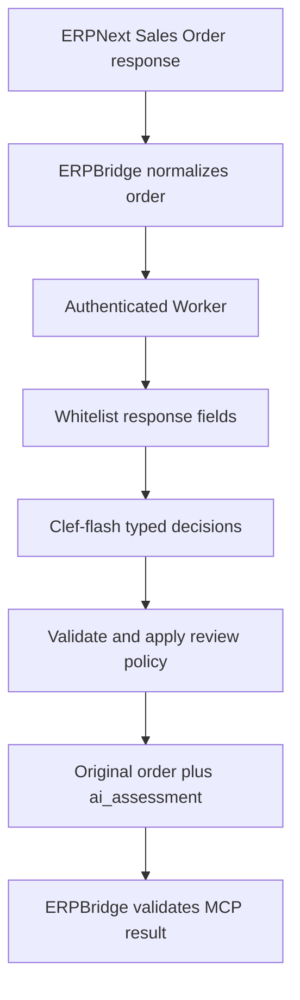

# Plan: Cloudflare Workers Clef-flash Sales Order Review Plugin

Status: local implementation complete and verified with mocked AI in `ERPBridge-Plugins`. The user selected Sales Order advisory review and `@cf/cloudflare/clef-flash`, then authorized moving the full project to this repository. Cloud deployment, server configuration, live inference, billing changes, and resource applications remain unauthorized.

This supersedes the Item stock/price aggregation proposal. The Worker makes no ERPNext requests and has no ERPNext credential.

## Goal

Add a sample `after_response` plugin that evaluates only the Sales Order response already returned by ERPBridge and appends `ai_assessment`. Use Cloudflare Workers AI through the Worker's `AI` binding. Keep existing tools, API registration, ERP permissions, client tokens, and infrastructure unchanged during local implementation.

## Evidence

This standalone project lives in `ERPBridge-Plugins`. Infrastructure remains in
sibling `../erpbridge-infra`. The existing mock plugin and release workflow are
preserved. Local checks use mocked AI, not live inference.

- ERPBridge's exact versioned plugin and binding resources, `after_response`, API-key references, v1 envelope, 1 MiB documents, and cache behavior are defined in `../ERPBridge/docs/plugin-schema.md:1-159`.
- `after_response` validates the original normalized result before plugin invocation. Its declared schema must therefore accept an order without `ai_assessment`. Source: `../ERPBridge/docs/plugin-schema.md:88-96`. Final validation is also required by the operations guide: `/home/nimendra/.agents/skills/bridgectl-ops/references/plugins.md`, Runtime contract.
- Sales Order native GET is `/resource/Sales%20Order/{name}` with a `data` object: `../erpbridge-infra/config/erpnext-openapi.yaml:5070-5112`. The inspected local generated manifest uses HTTPS, path input `name`, `responsePath: data`, and reference-only `ERP_PRIMARY_KEY` security. It is historical local evidence, not a fresh live readback. Future preparation requires a reviewed current manifest export and preserves its security.
- Existing broad onboarding protects current tool contracts and is not the publishing path for this sample: `../erpbridge-infra/scripts/onboard-erpnext.py:409-411`. The current catalogue's schema preservation limitation is documented at `../erpbridge-infra/docs/erpnext-tools.md:229-235`.
- ACA runs the active database at `/tmp/erpbridge.db`: `../erpbridge-infra/terraform/locals.tf:100-105`. A revision may lose registry/token state. Do not change server environment without accepted state recovery.
- Clef-flash accepts state plus typed questions and returns allowed-option probabilities: https://developers.cloudflare.com/workers-ai/models/clef-flash/. Exact API shapes: https://developers.cloudflare.com/workers-ai/models/clef-flash/schema-input.json and https://developers.cloudflare.com/workers-ai/models/clef-flash/schema-output.json.
- An AI binding exposes `env.AI.run`: https://developers.cloudflare.com/workers-ai/configuration/bindings/. No separate AI API token is embedded in the Worker.
- Free-tier published allowances: 100,000 HTTP requests/day, 10 ms Worker CPU per invocation, and 10,000 AI Neurons/day. Clef-flash is listed at 3,455 Neurons per million input tokens with no output-token charge. Sources: https://developers.cloudflare.com/workers/platform/limits/, https://developers.cloudflare.com/workers-ai/platform/pricing/. These are documented allowances, not verified account access or performance.
- Current official Workers runtime test setup uses `@cloudflare/vitest-plugin` and Vitest 4.1+: https://developers.cloudflare.com/workers/testing/vitest-integration/write-your-first-test/.

## Decisions

1. **Response-only AI enrichment.** No upstream ERP calls, ERP credentials, arbitrary HTTP requests, images, database, KV, queues, or automatic retries. One bounded model call at most. Unit/integration tests use mocked AI and block unmocked network access.
2. **Separate sample tool:** `get_sales_order_with_ai_review@1.0.0`, preserving the current Sales Order input/execution/security through a local manifest renderer. Plugin `sales-order-ai-review@1.0.0`, binding `sales-order-ai-review-v1`, phase `after_response`, priority 10, `failurePolicy: fail`.
3. **Fixed model and policy.** Call only `@cf/cloudflare/clef-flash`, with inner `model: "clef-flash"`, fixed typed questions, and config `{"policyVersion":"order-review-v1"}`. No prompt, model, endpoint, or threshold may be supplied through tool arguments or ERP free text.
4. **Advisory decisions only.** Fixed choices classify review queue and priority. Never approve, reject, write, submit, infer stock/payment/credit, or treat incomplete billing as overdue debt. Customer identifiers, contact details, addresses, arbitrary descriptions, and notes are excluded from model state. Treat every selected source field as untrusted data.
5. **Abstention and validation.** Missing required facts yield `insufficient_data`. Uncertain answers yield `uncertain` with abstaining choices. Reject malformed model identity, unknown options, non-finite/out-of-range numbers, invalid probability distributions, and inconsistent selected labels. Model probabilities are not correctness guarantees. Authentication, input, timeout, quota, or inference failures return safe non-2xx errors; no silent claim of successful assessment.
6. **Preserve native output.** Add only `ai_assessment`; reject upstream collisions. Root native order fields remain open. Nested assessment is closed. Tool output schema permits missing assessment for pre-plugin validation; Worker success requires it. An absent binding can return a plain order, so runtime acceptance explicitly checks active binding and assessment presence.
7. **No cache.** Disable sample tool response caching and return `Cache-Control: no-store`. AI output is not advertised as idempotent. Existing tool caches remain unchanged.
8. **Bounded free-tier operation.** Worker request maximum 64 KiB, selected model state maximum 8 KiB, no silent truncation, internal inference wait deadline 8 seconds, plugin timeout 15 seconds. A timeout does not guarantee cancellation of inference already started. Measure CPU, tokens, and latency before live acceptance. Never auto-upgrade a plan or purchase credits.
9. **Only a shared plugin key.** Worker `PLUGIN_API_KEY` must be a random secret of at least 32 characters. ERPBridge reference `PLUGIN_ORDER_REVIEW_KEY` supplies the same value in `X-API-Key`. Compare safely, authenticate before body/model processing, never log payloads, keys, or provider exception text. Runtime uses the `AI` binding, not an ERP credential.
10. **Inactive checked-in templates.** Commit inactive plugin/binding templates with a reserved `.invalid` endpoint. An explicit local renderer requires an actual HTTPS `workers.dev` origin and reviewed source tool export, writes active resources only into a fresh ignored `artifacts/` subdirectory, and never applies them. Existing Terraform and active catalogue stay unchanged in this scope.

## Implementation Tasks

- [x] **1. Worker project and locked tooling.** **Files:** `plugins/order-review/package.json`, lockfile, Wrangler/TypeScript/Vitest configuration, secret-free example, `.gitignore`. **Seam:** local Workers runtime. **Verify:** lockfile install, `npm --prefix plugins/order-review run typecheck`, and `npm --prefix plugins/order-review run build` (dry-run only).
- [x] **2. Protocol, state selection, and fixed AI assessment.** **Files:** `plugins/order-review/src/*`, `schema/*`, synthetic tests/fixtures. **Seam:** Worker fetch handler with mocked `env.AI.run`. **Verify:** `npm --prefix plugins/order-review test`; authentication failures produce zero model calls, no ERP/network requests, input/state/output bounds, missing/uncertain decisions, probability checks, safe model errors/deadline, exact model/tool/config, root-field preservation, schema agreement, and draft/cancelled/completed date scenarios.
- [x] **3. Additive local manifest preparation.** **Files:** `manifests/erpnext-order-review/plugin.json`, `binding.json`, `scripts/prepare-order-review.py`, `tests/test_order_review_manifests.py`. **Seam:** local JSON resource rendering and CLI validation. **Verify:** focused Python tests; inactive source templates; renderer preserves original execution/input/security and disables cache; exact version references and fail policy; rejects unreviewed endpoints, unsafe source contracts, and overwrites. Use `bridgectl --context erpbridge-demo tool validate -f <rendered-tool>`, `plugin validate -f <rendered-plugin>`, and `plugin binding validate -f <rendered-binding>` locally. No live readback is claimed.
- [x] **4. Offline CI and operational handoff.** **Files:** `.github/workflows/order-review-check.yml`, `docs/erpnext-order-review-plugin.md`, Worker README, this plan. **Seam:** non-deploying CI and runnable local checks. **Verify:** workflow runs typecheck, mocked runtime tests, dry-run bundle, and focused manifest tests; no cloud credentials, real inference, or apply step. Document free-tier estimates, account/performance gaps, schema limitation, exact deployment gates, and rollback.
- [x] **5. Final local acceptance.** **Files:** only the new sample implementation and directly related files. **Seam:** active diagnostics, focused tests, existing regression tests where practical, independent read-only review. **Verify:** changed-file diagnostics, typecheck, complete new Worker suite, manifest tests/local CLI validation, dry-run build, and whitespace checks. Record unsupported diagnostics and pre-existing failures separately. Do not claim live integration or free-tier latency acceptance.

## Local Verification Results

- Lockfile installation passed with `npm ci --ignore-scripts`; audit reported no vulnerabilities.
- Typecheck passed; 72 mocked Workers-runtime tests passed; dry-run bundle passed (15.71 KiB uncompressed, 4.91 KiB gzip).
- All 9 standalone Python manifest tests passed. Synthetic rendered tool, plugin, and binding passed installed `bridgectl` local validation; no apply occurred.
- Existing `plugins/mock-plugin` Go tests passed with `GOTOOLCHAIN=local`. Its files and release workflow were not modified.
- An active diagnostic scan of seven changed code/config paths found no errors or warnings. Boundary-validation style hints remain informational. Whitespace checks passed.
- Independent read-only review of the supplied Worker/test/config snapshot found no blocker. The reviewer could not access sibling files directly, so no independent live or filesystem-wide acceptance is claimed.
- Tests ran locally on Node 26.8.1. The package also declares Node 22.12+/24 support and CI selects Node 22; hosted CI was not executed here.
- No account/model access, real inference quality, free-tier CPU budget/latency, Worker deployment, ERPBridge mutation, or live MCP integration was tested.

## Future Deployment Gates (not authorized)

- [ ] **Cloudflare account and synthetic inference.** Confirm free-tier access to this exact model and Workers deployment permissions, approve deployment/key creation, set provider secret and AI binding, deploy to an actual account-issued `workers.dev` endpoint. Separately approve a bounded synthetic live assessment. Measure CPU, input tokens/Neurons, rate/quota failures, and latency. No paid plan or credit purchase without approval. **Files:** provider-managed Worker release/secrets; no committed secret values. **Seam:** direct Worker endpoint. **Verify:** correct authentication, actual assessment, quota/error behavior, and budget/CPU headroom.
- [ ] **Bridge configuration preservation.** Run bridgectl-ops preflight with explicit context, current server/client versions, and resource ownership. Establish accepted SQLite registry/token-hash recovery before any ACA revision. Stop if unavailable. Approve exact endpoint allowlist entry and secret reference while preserving existing entries and tools. **Files:** reviewed future server configuration only. **Seam:** server configuration and restored registry. **Verify:** existing MCP tokens and original tools remain valid. No broad re-onboarding or persistence refactor is authorized.
- [ ] **Exact resource activation and MCP acceptance.** Review current Sales Order security, render fresh manifests, validate and separately approve tool, plugin, then binding applies. Read back exact versions, stored output schema, cache policy, and active binding. **Files:** ignored rendered manifests and bounded redacted evidence; update catalogue only after success. **Seam:** control plane and MCP. **Verify:** original order fields plus required advisory assessment; absent assessment fails acceptance; original `get_sales_order`, existing client tokens, and ERP permissions unchanged. Live fault injection needs isolated resources and approval.

## Rollback

For local work, remove only new sample files and the scoped ignore entries; preserve unrelated working-tree changes. No cloud resource exists from local preparation.

After a future deployment, deactivate the new sample tool first, then its binding and plugin using exact identities and supported soft-deactivation commands. Keep original tools/API/permissions/data untouched. Keep Worker availability until rollback is verified. Removing bridge environment settings can cause another ACA revision and requires the same state-recovery gate. Worker cleanup or code rollback needs explicit approval. No hard delete or global cache flush is required.

## Open Questions

No local design choice remains open. Account access, actual model latency/quality, free-tier CPU headroom, installed server compatibility, and safe bridge-state recovery remain live deployment gates, not accepted results.
